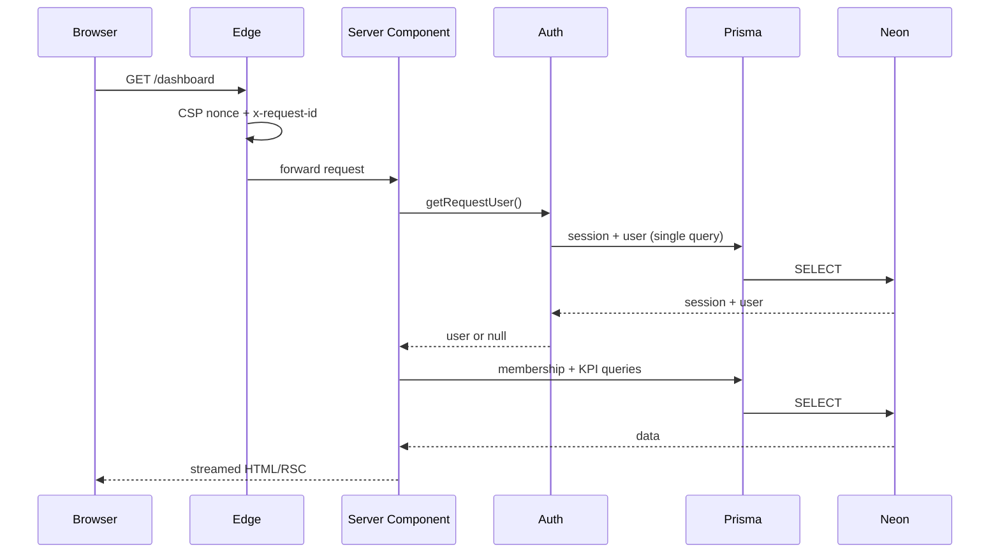
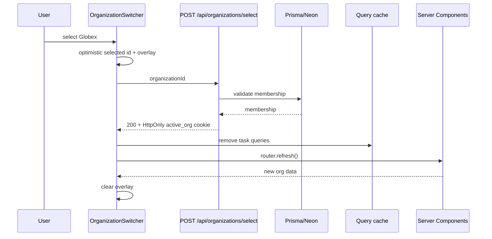
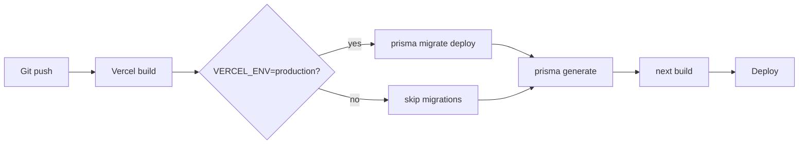
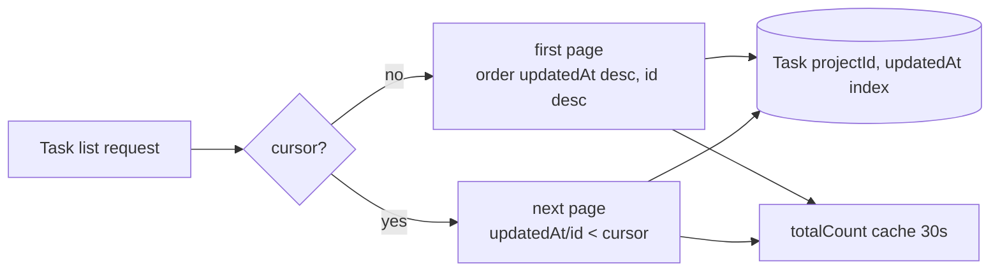

# Architecture

## System context

```mermaid
flowchart LR
  B[Browser] --> E[Vercel Edge Middleware<br/>CSP nonce · request id · cheap auth gate]
  E --> N[Next.js App Router<br/>Server Components · streaming]
  N --> A[Auth<br/>JWT + revocable Session]
  N --> Q[TanStack Query<br/>prefetch + hydration]
  N --> P[Prisma]
  P --> DB[(Neon PostgreSQL<br/>eu-central-1)]
  N --> C[KPI cache<br/>unstable_cache + tag]
  N --> U[(Upstash Redis<br/>optional rate limit)]
  N --> V[/api/vitals<br/>Web Vitals]
```

The middleware makes **no authorization decision**. It only provides a cheap
redirect gate and request-level headers. Authorization is re-derived in every
Node route and server component. See ADR 0006.

## Request lifecycle: authenticated dashboard



## Organization switch



If the server does not confirm within five seconds, the switcher reverts to the
previous organization and shows an error. The UI never claims a tenant switch
that the server has not accepted.

## Deployment pipeline



Migrations are production-only on purpose: preview deployments must not mutate
the production database. See `docs/runbook.md`.

## Data and pagination



## Failure boundaries

| Failure | Behavior |
|---|---|
| Expired/revoked session | Server resolves null; dashboard redirects to login |
| Cross-tenant mutation | 403; optimistic state rolls back; notification |
| Last admin demotion | 400 inside serializable transaction |
| Org switch timeout | Revert select + accessible error after 5s |
| Migration conflict | Production build fails closed; runbook documents reconciliation |
| DB down | `/api/health` 503; dashboard error boundary |

## Decisions

- [ADR index](./adr/README.md)
- [Custom JWT + sessions](./adr/0001-custom-jwt-and-sessions.md)
- [Active organization cookie](./adr/0002-active-organization-cookie.md)
- [Cursor pagination](./adr/0003-cursor-pagination.md)
- [Observability without Edge bloat](./adr/0004-observability-without-edge-bloat.md)
- [Single pagination path](./adr/0005-single-pagination-path-and-hydrated-auth.md)
- [Edge middleware makes no security decisions](./adr/0006-edge-middleware-makes-no-security-decisions.md)
- [Enterprise identity and audit](./adr/0007-enterprise-identity-and-audit.md)
